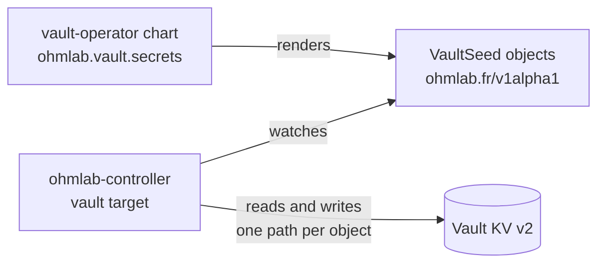

# The ohmlab controller

The controller keeps the platform's backends configured from Kubernetes objects. It runs continuously, so a value that was deleted or edited by hand is corrected without waiting for a sync, and every object reports its own status. Today it configures Vault; Harbor and SonarQube follow.

It does not deploy anything. Argo CD does that, starting from the `ohmlab` bootstrap chart ([03-installation.md](03-installation.md)). The controller is one of the apps the instance's `core.yaml` lists, and the objects it reads are rendered by the charts that own the configuration, for example `vault-operator`.



## Enabling it

1. The `ohmlab-controller` chart ships with every target off. Enable the Vault target and name the objects' namespace in the instance values (`argo-cd/instances/<instance>/values/core/ohmlab-controller.yaml`), and list the app in `core.yaml` with a sync wave just before `vault-operator`.
2. In the `vault-operator` instance values, set `ohmlab.controller.enabled: true`. The chart then grants the controller its Vault policy and Kubernetes-auth role.
3. Set `ohmlab.vault.seeds.enabled: true` to render one `VaultSeed` per entry of `ohmlab.vault.secrets`.

An instance can run the target with `observeOnly: true` first: the whole reconcile happens and nothing is written. Each object's `Drifted` condition and the `ohmlab_planned_changes` metric say what a real run would do.

## VaultSeed

One object is one KV v2 path.

```yaml
apiVersion: ohmlab.fr/v1alpha1
kind: VaultSeed
metadata:
  name: production-core-keycloak
  namespace: vault-operator-system
spec:
  path: homelab/platforms/production/core/keycloak   # <mount>/<path>
  data:
    admin:
      username: admin
      password: "<random:24>"
      passwordHashed: "<bcrypt:admin.password>"
    clients:
      grafana-core:
        clientSecret: "<random:32>"
    webhook: ""                                       # filled in by hand
  rotate:                                             # optional
    token: "2026-10-12"
    keys: [admin.password]
  prune: false                                        # default
  deletionPolicy: Retain                              # default
```

| Field | Meaning |
| --- | --- |
| `path` | `<mount>/<path>` of the secret. Immutable: delete the object and create another. |
| `data` | The tree the path must hold. Leaves are plain values or templates. A key name must not contain a dot. |
| `rotate.token`, `rotate.keys` | Regenerate generated keys once per distinct token. No `keys` means every generated key. |
| `prune` | Remove the keys this controller wrote that `data` no longer declares. |
| `deletionPolicy` | `Retain` leaves the path in Vault when the object is deleted; `Delete` removes it (see [Deletion](#deletion)). |

### Templates

| Template | Value |
| --- | --- |
| `<random:N>` | Random alphanumeric string of N characters (1 to 4096). |
| `<hex:N>` | Random lowercase hex string of N characters (N even). |
| `<uuid>` | Random UUID v4. |
| `<age:secret>`, `<age:public>` | An age X25519 key pair. Within one path the two always belong together. |
| `<bcrypt:key.path>` | The bcrypt hash of another key of the same path. |
| `<ref:mount/path#key.path>` | A copy of a key of another path. |

### What the controller does with a path

- **Seed once.** A key that exists is never overwritten, whether a template made it or a person typed it. A key that is missing is generated. A placeholder declared as `""` stays what a person put there. Changing a template (for example a longer `<random:N>`) does not touch the existing value; rotate it instead.
- **References follow their source.** A key declared as `<ref:...>` is a copy, so it is kept equal to its source at every resync. A reference whose source is missing or empty waits (`RefPending`) and the object writes nothing until every missing key can be computed. A bcrypt hash is rewritten only when it stops matching the key it hashes, so a resync never produces a new salt.
- **Compare and set.** Every write names the KV version it read. If somebody wrote in between, the controller reads again and plans again, so an edit made at that moment is kept.
- **Adoption.** A path created before the object existed (by the old post-config Job, or by hand) is adopted: the controller records its owner in the path's custom metadata and leaves the data alone. A path whose owner marker names another object is not touched (`OwnedByAnother`).
- **Rotation.** `rotate.token` is compared with the one recorded on the path. When they differ, the listed keys (or every generated key) are regenerated once and the token is recorded. Leaving the token in place does nothing on later resyncs. The token is recorded after the keys are written: if Vault refuses to record it, the next attempt regenerates the keys again (one more KV version) until it is recorded, and the object reports `Forbidden`.
- **Pruning.** With `prune: true`, keys the controller wrote and the object no longer declares are removed. `status.managedKeys` lists those keys by name; keys written by anybody else are never removed, and an object that lost its status prunes nothing.
- **Quiet resyncs.** An object is reconciled again every ten minutes. A resync that finds nothing to do writes nothing to Vault and nothing to the Kubernetes API.

### Deletion

Deleting an object never blocks by default and never touches Vault. With `deletionPolicy: Delete` the object carries a finalizer and removes its path when it is deleted, provided the path carries this object's owner marker. That needs two switches, because it is destructive: `targets.vault.allowDelete: true` in the controller's chart, and `ohmlab.controller.allowDelete: true` in `vault-operator` (which adds `delete` on the metadata path to the controller's Vault policy). Without the first, an object asking for `Delete` reports `Stalled` with reason `Forbidden` and no finalizer is added.

### Conditions

| Condition | Meaning |
| --- | --- |
| `Ready` | `True` when the path holds what is declared. |
| `Reconciling` | `True` while the object waits for something and retries with backoff (5s doubling to 5m). |
| `Stalled` | `True` when the controller cannot go on as declared. It is checked again at every resync, never with a backoff: a cycle ends when the other object is fixed, and a hash of a value that is still empty ends when the value is filled in. |
| `Drifted` | `True` in observe-only mode when a real run would change something. |

| Reason | Condition | What to do |
| --- | --- | --- |
| `Reconciled` | `Ready` | Nothing. |
| `RefPending` | `Ready=False`, `Reconciling` | A `<ref:>` source is missing or empty. Create it, or fix the reference. |
| `RefCycle` | `Stalled` | Objects reference each other. The message lists the paths. |
| `InvalidSpec`, `InvalidRotation` | `Stalled` | The message names the key and the problem. `ohmlab validate` finds them before merge. |
| `OwnedByAnother` | `Ready=False` | Another object owns the path. Delete one of the two, or remove the owner marker by hand to hand the path over. |
| `Forbidden` | `Ready=False` or `Stalled` | Vault refused: its login role is missing or does not accept the controller's ServiceAccount (the message carries Vault's reason), the policy of the role does not cover the path, or a `Delete` was asked without being allowed. |
| `BackendUnavailable` | `Ready=False`, `Reconciling` | Vault does not answer: sealed, restarting or unreachable. |
| `ObserveOnly` | `Ready=False`, `Drifted` | Observe-only mode would change the path. |

Events are emitted when an object enters a failing state and when the controller writes, adopts, rotates or deletes. They name keys and counts, never values.

## Topologies

The unit is the **target**; a Deployment is only packaging. By default each enabled target gets its own Deployment, ServiceAccount, RBAC, Vault role and network egress (`split`). The chart's `deployments` map groups targets into shared processes, for example `{all: [vault, harbor, sonarqube]}`, or `{vault: [vault], apps: [harbor, sonarqube]}` to keep Vault alone. Every enabled target must appear exactly once.

Whatever the grouping, each target runs its own manager: its own cache, work queue and Lease (`ohmlab-controller-<target>`). A rolling update therefore never runs a target twice, and one process serves one metrics and one probe endpoint.

A shared process is not a security boundary. What is isolated and what is not:

| | `split` | one process for several targets |
| --- | --- | --- |
| Memory, OOM limit, failure domain | per target | shared |
| ServiceAccount, RBAC, network egress | per target | shared (the union) |
| Backend credentials in memory | per target | each target holds only its own; the packages cannot import each other (checked in CI) |
| Configuration | each process receives only its targets' sections | same |
| Logs, concurrency, timeouts, panics | per target | per target |
| Probes | the process | the process; a target whose backend is down never fails them |

## Security

- **Objects say what, never where or as whom.** Backend addresses and credentials live in the controller's configuration, so no object can point the controller at another endpoint.
- **Namespaces.** A target reconciles only the namespaces its chart lists. Objects anywhere else are ignored. Only Argo CD and cluster administrators can write in them.
- **Vault.** The Vault target logs in with its ServiceAccount token under a role bound to that ServiceAccount, with a 15-minute token it replaces before it expires. Its policy covers KV data and metadata under `platforms/+/+/*` and nothing else: no identity, policies, auth methods, mounts or tokens. Deleting needs the extra grant described above.
- **Kubernetes.** Roles in the watched namespaces (not ClusterRoles), a Role for its own Leases, and one ClusterRole that reads its own CRDs by name. No access to Secrets.
- **Pod.** Restricted Pod Security (non-root numeric user, read-only root filesystem, no capabilities, `RuntimeDefault` seccomp), a distroless image with no shell, signed with SLSA provenance (Kyverno's `verify-images` policy covers it), a default-deny network policy when the instance turns on the chart's `networkPolicy` (off by default), with the egress to the API server, DNS and Vault written in `extraEgress`.
- **No secret material** in an object's spec (templates only), status, events, logs or metric labels. Status holds key names and KV versions.

## Operating

Metrics, alerts and a dashboard come with the chart. The alerts: `OhmlabControllerDown`, `OhmlabObjectNotReady`, `OhmlabReconcileStale` (three resyncs without a completed reconcile), `OhmlabBackendErrors`, `OhmlabBackendForbidden`, `OhmlabWriteLoop` (a sustained rate of data writes, which means something else rewrites the path), `OhmlabCRDRevisionMismatch`.

```sh
kubectl get vaultseeds -A                       # path, Ready, reason
kubectl -n vault-operator-system describe vaultseed production-core-keycloak
```

- **An object stays `RefPending` after its source exists.** The retry delay grows to five minutes; touch the object (an annotation change does not count, the spec must change) or wait.
- **A deleted object's finalizer will not clear.** Only `deletionPolicy: Delete` adds one. Read the `Forbidden` or `BackendUnavailable` condition. Once the cause is fixed it finishes by itself; to give up on removing the path, patch the finalizer away: `kubectl patch vaultseed <name> -p '{"metadata":{"finalizers":null}}' --type merge`.
- **`OhmlabCRDRevisionMismatch`.** The CRDs come from the catalog and the image from its pin, and they were released apart. Bring the lagging one up to the same release.
- **The `VaultSeed` objects do not appear on a new cluster.** `vault-operator` renders them only once the kind exists, and Argo CD caches a render. Hard-refresh the `vault-operator` application after the `ohmlab-controller` application has synced.
- **A path was changed by hand.** Keys the objects declare as references are put back at the next resync. Anything else you changed stays.

## Checking objects before merge

`ohmlab validate` checks objects without a cluster, from files or from a rendered chart:

```sh
helm template vault-operator argo-cd/apps/vault-operator -f argo-cd/instances/<instance>/values/core/vault-operator.yaml \
  --set ohmlab.vault.seeds.enabled=true --set ohmlab.vault.seeds.requireCRD=false | ohmlab validate -
```

It reports malformed templates, bcrypt targets and rotation keys that do not exist, key names with a dot, two objects on one path, repeated names and reference cycles. CI runs it over every instance.

## Migrating from the post-config Job

The `vault-post-config` Job ran `ohmlab vault secret` after every sync of `vault-operator`. The controller replaces it with the same semantics, except that a reference now follows its source, rotation is a one-shot token instead of `forceRotate`, and nothing waits for a hook. The move happens in three steps on a live instance:

1. **Shadow.** Enable the target with `observeOnly: true` and render the objects. The Job stays the only writer. The expected planned changes are `adopt` only; when a day passes without an unexpected one, go on.
2. **Takeover.** Set `observeOnly: false`. The first reconcile writes only the owner markers, which creates no KV version. The Job can stay for one sync as a safety net. To go back, set `observeOnly: true`.
3. **Clean-up.** Remove the Job, its ServiceAccount, RBAC, Vault role and policy, and `forceRotate`.

Identity groups and their OIDC aliases are not the controller's: the `vault-operator` chart renders `ohmlab.vault.identity` into the Vault resource's `externalConfig`, where bank-vaults applies them.

## Not covered yet

Harbor and SonarQube have target names reserved and no objects yet. Objects owned by applications in their own namespaces (so an adopter's app can declare its own configuration) are a later addition: the allow-list and the owner markers are what it will build on.
